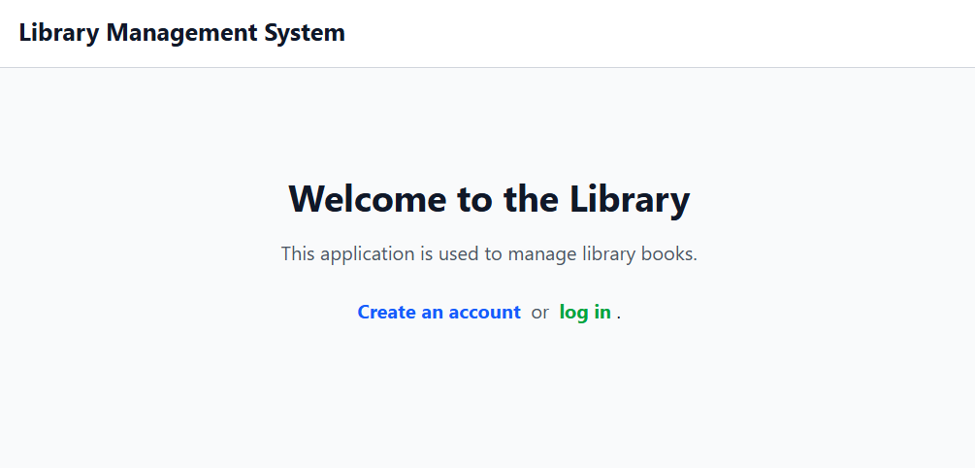
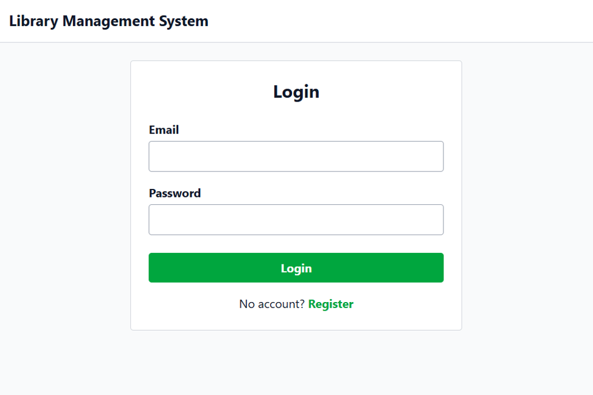
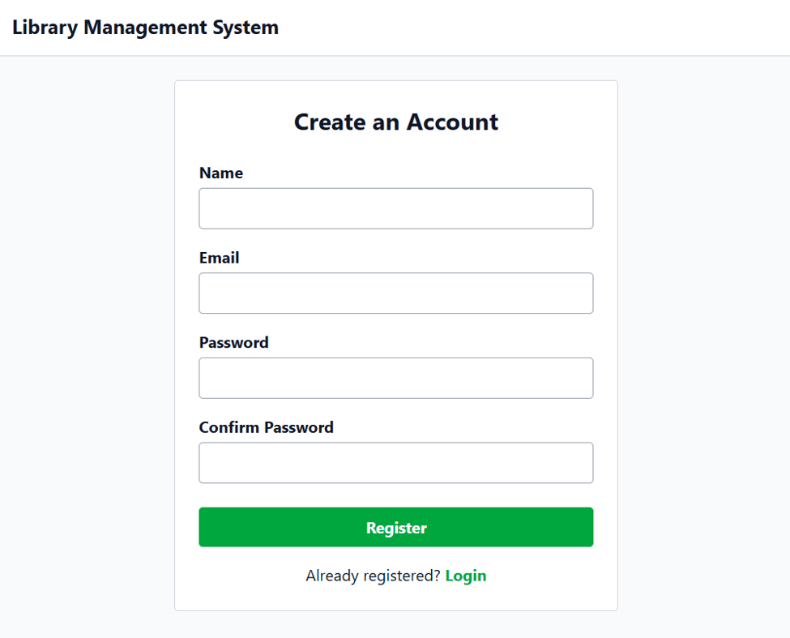
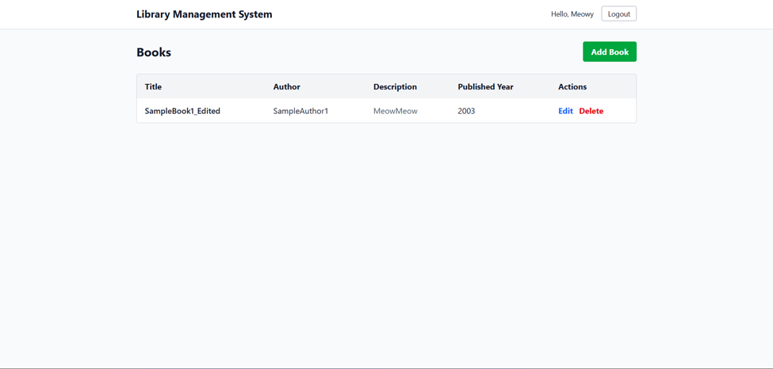
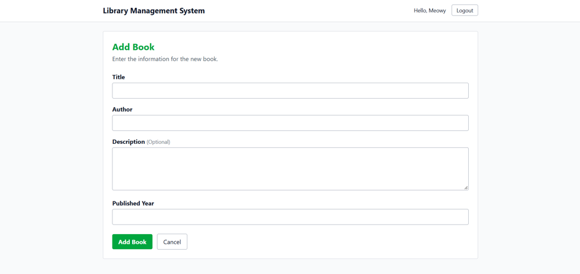
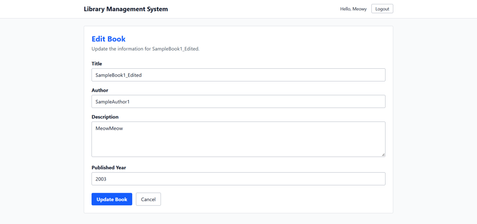

# Library Management System

This is a basic library management system made with Laravel 12. Users can register, log in, and manage books.

## Features

- Register, login, and logout
- View books
- Add books
- Edit books
- Delete books
- Form validation
- Protected book pages

## Built With

- Laravel 12
- PHP
- SQLite
- Blade
- Tailwind CSS

## Setup

Clone the repository:

```powershell
git clone https://github.com/MakPongase/LibraryExam.git
cd LibraryExam
```

Install the dependencies:

```powershell
composer install
npm install
```

Create the environment file:

```powershell
Copy-Item .env.example .env
```

Generate the application key:

```powershell
php artisan key:generate
```

Make sure `.env` uses SQLite:

```env
DB_CONNECTION=sqlite
```

Create an empty file named `database.sqlite` inside the `database` folder.

Run the migrations:

```powershell
php artisan migrate
```

## Run the Project

Run Vite:

```powershell
npm run dev
```

Open another PowerShell terminal and run Laravel:

```powershell
php artisan serve
```

If Laravel Herd is being used, `php artisan serve` is not needed.

## Project Notes

I used SQLite because it was easier to set up and does not need a separate database server.

Laravel already included the users migration, so I created another migration for the books table. The books table contains the title, author, description, published year, and timestamps.

I used separate controllers for register, login, and logout. I used a resource controller for the book CRUD operations.

I completed the functions first before adding the Tailwind CSS design.

## Screenshots

### Login Page




### Books Page 




## References

- [Laravel Documentation](https://laravel.com/docs/12.x)
- [Laravel Authentication Lessons](https://laravel.com/learn/getting-started-with-laravel/basic-authentication-registration)
- [Tailwind CSS Documentation](https://tailwindcss.com/docs/styling-with-utility-classes)